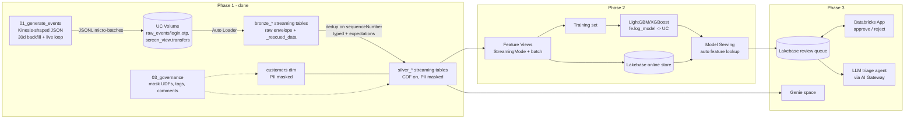

# FE Bar prototype: real-time fraud scoring for cross-border remittances

This prototype scores every remittance transfer in near real time using per-customer behavioral stream features (logins, OTP challenges, screen views, transfer history). Fraud analysts review the transfers it flags. **All data is synthetic.** No real customer data is used, and there are no secrets in code.

Stack: Python only, serverless compute wherever possible, Unity Catalog `mlo_serverless_stable_catalog.fraud_rt`.

## Architecture



ASCII fallback:

```
01_generate_events --> /Volumes/.../raw_events/{login,otp,screen_view,transfers}/*.json
        |                         |
        v                         v  Auto Loader (SDP, serverless)
  customers (dim)          bronze_{login,otp,screen_view,transfers}
                                  |  dropDuplicatesWithinWatermark(sequenceNumber), cast, expectations
                                  v
                           silver_{login,otp,screen_view,transfers}  (CDF, masks, tags)
                                  |
                    [Phase 2] Feature Views -> Lakebase online store -> Model Serving
                    [Phase 3] Lakebase review queue <-> App, Genie, LLM triage
```

## Repo layout

| Path | What |
| --- | --- |
| `notebooks/01_generate_events` | Synthetic generator: customer universe, legit / hard-negative / account-takeover sessions, Kinesis envelope, backfill + live loop, landing validation |
| `02_pipeline/transformations/bronze/*.py` | Auto Loader bronze streaming tables, one per stream |
| `02_pipeline/transformations/silver/*.py` | Typed, deduplicated silver streaming tables with expectations, CDF, column comments and masks |
| `02_pipeline/pipeline_settings.json` | Pipeline settings snapshot (serverless, triggered, config keys) |
| `notebooks/03_governance` | Mask UDFs, masks on `customers`, table/column tags and comments, verification |

Notebooks are committed **with outputs**, which serve as run evidence.

## How to run

1. Run `notebooks/01_generate_events`. The default `mode=backfill_and_live` writes the 30-day backfill once, guarded by `raw_events/_meta/backfill_done.json`, then runs 60 s of live micro-batches every 5 s. Re-run with `mode=live` and a longer `live_duration_seconds` for demos.
2. Run cells 1-3 of `notebooks/03_governance` to create the mask functions. The pipeline references them.
3. Run the `fraud_rt_02_pipeline` pipeline. It is triggered, so run it again after more live data lands, or switch it to continuous.
4. Run the rest of `notebooks/03_governance` (tags, customer masks, verification).

## Phase 1 results (run evidence is in the notebook outputs)

| Stream | Raw records | Distinct sequenceNumber | Silver rows |
| --- | --- | --- | --- |
| login | 126,617 | 125,978 | 125,740 |
| otp | 34,973 | 34,811 | 34,722 |
| screen_view | 587,483 | 584,608 | 583,449 |
| transfers | 33,260 | 33,100 | 33,029 |

Counts are as of the 30-day backfill plus 24 live micro-batches per stream (two 60 s live runs).

* An independent recompute from the raw JSON (distinct `sequenceNumber`, then the same drop rules) exactly matches the silver row counts. Silver has no duplicate sequence numbers.
* 5,000 customers, 100 (2.0%) fraudster accounts, 197 ATO incidents in the backfill.
* In silver, 254 fraud transfers (0.77%). Average amount is $2,755 for fraud vs $314 for legit.
* 10 column masks (device_id / ip / phone across silver + customers), confirmed in `information_schema.column_masks`.

## Decisions and trade-offs

### Setup
* **Schema in the default catalog** (`mlo_serverless_stable_catalog.fraud_rt`), not a new catalog. This avoids needing metastore-level CREATE CATALOG. The catalog name is a widget or pipeline config value, so moving it is a one-line change.
* **Managed volume** as the landing zone. It stands in for a Kinesis stream: Auto Loader on a volume behaves like a Kinesis consumer for the prototype and needs no AWS credentials. In production you would swap the bronze reader for `spark.readStream.format("kinesis")` with a UC service credential. The silver layer stays unchanged because the envelope is identical.

### Generator
* **Kinesis envelope kept as-is** (`partitionKey`, `sequenceNumber`, `approximateArrivalTimestamp`, `data`). `partitionKey = customer_id` mirrors per-customer shard ordering. Sequence numbers are prefixed with a per-run epoch, so they never collide across runs.
* **Behavioral realism over volume.** Sessions are simulated end to end (login, OTP, screens, transfer), so features like "failed OTP in 10m" and "screen hops" fall out naturally.
* **Not trivially separable on purpose.** 25% of ATO incidents are *partial* (no OTP burst, fewer hops). About 1% of legit sessions are *hard negatives* (travel: new device, foreign geo, OTP retries, 1.5-3x amount). Legit users also get new devices about 1% of the time.
* **Label placement.** `is_fraud` lives only on transfers, as requested. It is tagged `fraud_rt_ml_role=label`. The `customers` table intentionally has no fraudster flag, to avoid leakage. Real labels would arrive late (chargebacks, analyst decisions); Phase 3 review outcomes can become that feedback loop.
* **Deliberate dirt.** About 0.5% same-sequenceNumber duplicates (consumer replay) and about 0.2% malformed payloads exercise dedup and expectations. About 1% of records arrive 30-600 s late.
* **Atomic writes.** Files are written to `_staging` and then moved, so Auto Loader never reads a partial file.
* **Fraud rate.** 2% of *accounts* are fraudsters, which gives about 0.8% of *transfers*. That is realistic for remittance ATO, but the class imbalance matters for Phase 2 (precision at top 2%).

### Pipeline (SDP, serverless, triggered)
* **One streaming table per stream and layer** (8 files) rather than a generated loop. This is more verbose but easier to read, review and extend per stream.
* **Bronze: inferred schema + hints + `_rescued_data`.** This tolerates new payload fields. An expectation watches `_rescued_data IS NULL`.
* **Dedup = `dropDuplicatesWithinWatermark(sequenceNumber)` with a 1 h watermark on `_ingested_at`.** I chose ingestion time over event or arrival time because the 30-day backfill carries old timestamps: an event-time watermark could drop backfill rows if Auto Loader splits it across micro-batches. Trade-off: a replay that arrives more than 1 h later would not be caught. AUTO CDC keyed on sequenceNumber would give exact global dedup, but it makes silver non-append-only, which complicates streaming Feature Views. That is why I chose an append-only silver.
* **Expectations.** Drop rows with no key, customer or timestamp, or with amount <= 0 (these are unusable for features). Warn on domain checks (known corridor, payout method, status, dwell >= 0, amount < 10k, late arrival > 15 min) so they appear in pipeline metrics without losing data. A quarantine table for dropped rows is a possible add-on.
* **CDF enabled on silver** (`delta.enableChangeDataFeed=true`) for incremental downstream consumers. Liquid clustering on `(customer_id, event_ts)` matches the feature-lookup access pattern.
* **Triggered, development mode** for cost during the prototype. For the live demo, use continuous mode or a file-arrival job trigger.

### Governance
* **Masks declared in the pipeline schema** for silver, because SDP owns those tables (ALTER-based masks are not supported on pipeline-managed tables). `customers` is a regular table, so its masks are applied with `ALTER TABLE ... SET MASK`.
* **Privileged group = `admins`** (workspace or account group, widget-configurable). Non-members see masked values.
* **device_id is masked as a deterministic hash token**, not redacted. Non-admin consumers (analysts, Genie, and feature jobs running as a non-admin principal) can still count distinct devices and join on device without seeing the raw ID. ip keeps 2 octets; phone keeps the last 4 digits.
* **Bronze is not masked.** It keeps the raw payload for replay and debugging and is tagged `fraud_rt_access=engineering_only`. Do not grant it to analyst groups.
* **Tag keys are prefixed `fraud_rt_`.** This shared workspace has about 1,000 account-level governed tag policies; for example, `pii` and `pii_type` only allow certain values. Using a project prefix avoids collisions. PII columns also carry the built-in classification keys `class.phone_number` / `class.ip_address`, so ABAC policies can target them later. A schema-wide ABAC policy is the scale-out path for masking.
* **Not tested:** masked output as seen by a non-admin user. The author is a workspace admin; the notebook only previews the mask's else-branch output.

## Git

This repo is the Databricks Git folder `/Workspace/Users/mike.lo@databricks.com/rt-fraud-fs`, linked to `https://github.com/mik3lol/rt-fraud-fs` (branch `main`). Notebooks are `.ipynb` and are committed with outputs as run evidence. That requires the workspace admin setting "Allow repos to export IPYNB output" and the `.databricks/commit_outputs` config.

## Next phases

* **Phase 2:** Feature Views (StreamingMode) on silver keyed by customer_id. Examples: failed OTP 10m/1h, distinct devices 24h, logins 1h, last 10 screens, transfer sum 7d/30d, plus a batch 30-day corridor-history view. Lakebase online store, LightGBM with `fe.log_model`, UC registration, Model Serving, AUC and precision at top 2%.
* **Phase 3:** Lakebase review queue, Genie space, Databricks App (approve/reject), optional LLM triage via AI Gateway.
