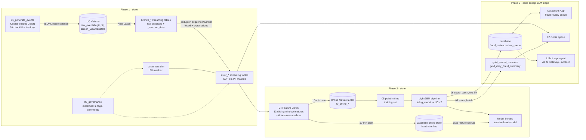

# FE Bar prototype: real-time fraud scoring for cross-border remittances

This prototype scores every remittance transfer in near real time using per-customer behavioral stream features (logins, OTP challenges, screen views, transfer history). Fraud analysts review the transfers it flags. **All data is synthetic.** No real customer data is used, and there are no secrets in code.

Stack: Python only, serverless compute wherever possible, Unity Catalog `mlo_serverless_stable_catalog.fraud_rt`.

## Architecture



ASCII fallback:

```
01_generate_events --> /Volumes/.../raw_events/{login,otp,screen_view,transfers}/*.json
        |                         |
        v                         v  Auto Loader (SDP, serverless)
  customers (dim)          bronze_{login,otp,screen_view,transfers}
                                  |  dropDuplicatesWithinWatermark(sequenceNumber), cast, expectations
                                  v
                           silver_{login,otp,screen_view,transfers}  (CDF, masks, tags)
                                  |
                    [Phase 2] Feature Views (10-min cron) -> offline tables + Lakebase online store
                              -> training set -> LightGBM (fe.log_model, UC) -> Model Serving (online lookup)
                    [Phase 3] score_batch -> Lakebase review queue <-> Streamlit app (approve/reject/escalate)
                              score_batch -> gold tables -> Genie space (silver + gold)
```

## Repo layout

| Path | What |
| --- | --- |
| `notebooks/01_generate_events` | Synthetic generator: customer universe, legit / hard-negative / account-takeover sessions, Kinesis envelope, backfill + live loop, landing validation |
| `02_pipeline/transformations/bronze/*.py` | Auto Loader bronze streaming tables, one per stream |
| `02_pipeline/transformations/silver/*.py` | Typed, deduplicated silver streaming tables with expectations, CDF, column comments and masks |
| `02_pipeline/pipeline_settings.json` | Pipeline settings snapshot (serverless, triggered, config keys) |
| `notebooks/03_governance` | Mask UDFs, masks on `customers`, table/column tags and comments, verification |
| `notebooks/04_feature_views` | 13 Feature Views + 6 freshness anchors, SQL parity check, Lakebase online store, materialization, freshness check |
| `notebooks/05_train_model` | Point-in-time training set, EDA and leakage screen, LightGBM pipeline, holdout metrics, `fe.log_model`, isolated serving check, UC registration, endpoint, fraud+legit smoke test with online-feature parity |
| `notebooks/06_review_queue` | Lakebase `fraud_review.review_queue` + `review_actions` DDL, batch scoring, top-2% flagging, idempotent upsert that never overwrites analyst decisions |
| `notebooks/07_genie_space` | Genie space definition (silver + gold tables, instructions, validated example SQL, sample questions), create/update, smoke question |
| `notebooks/08_gold_tables` | `gold_scored_transfers` and `gold_daily_fraud_summary` for Genie |
| `app/` | Streamlit review-queue app (`app.py`, `app.yaml`, `requirements.txt`) |
| `genie/genie_space_config.json` | Export of the Genie space (id, tables, instructions, example SQL, sample questions). The space asset itself lives in the workspace folder but is git-ignored, because Git folders cannot hold Genie space assets |
| `run_evidence/*.ipynb.json`, `run_evidence/*.job_run.html` | Run evidence: Jupyter exports with outputs for interactively run notebooks, and rendered job-run outputs for `07` and `08` (run as a one-time job); see Git below |

## How to run

1. Run `notebooks/01_generate_events`. The default `mode=backfill_and_live` writes the 30-day backfill once, guarded by `raw_events/_meta/backfill_done.json`, then runs 60 s of live micro-batches every 5 s. Re-run with `mode=live` and a longer `live_duration_seconds` for demos.
2. Run cells 1-3 of `notebooks/03_governance` to create the mask functions. The pipeline references them.
3. Run the `fraud_rt_02_pipeline` pipeline. It is triggered, so run it again after more live data lands, or switch it to continuous.
4. Run the rest of `notebooks/03_governance` (tags, customer masks, verification).
5. Run `notebooks/04_feature_views` to register features, create the online store and materialize (this sets up 8 refresh jobs on a 10-minute cron).
6. Run `notebooks/05_train_model` to train, evaluate, log, register and deploy `transfer-fraud-model`.
7. Run `notebooks/06_review_queue` to score recent transfers and load the Lakebase review queue.
8. Run `notebooks/08_gold_tables`, then `notebooks/07_genie_space`, to build the gold tables and update the Genie space.
9. Deploy the app from `app/` (`fraud-review-queue`). Warm up the endpoint first: it scales to zero, and the first call can exceed 60 s.

## Phase 1 results (run evidence is in the notebook outputs)

| Stream | Raw records | Distinct sequenceNumber | Silver rows |
| --- | --- | --- | --- |
| login | 126,617 | 125,978 | 125,740 |
| otp | 34,973 | 34,811 | 34,722 |
| screen_view | 587,483 | 584,608 | 583,449 |
| transfers | 33,260 | 33,100 | 33,029 |

Counts are as of the 30-day backfill plus 24 live micro-batches per stream (two 60 s live runs).

* An independent recompute from the raw JSON (distinct `sequenceNumber`, then the same drop rules) exactly matches the silver row counts. Silver has no duplicate sequence numbers.
* 5,000 customers, 100 (2.0%) fraudster accounts, 197 ATO incidents in the backfill.
* In silver, 254 fraud transfers (0.77%). Average amount is $2,755 for fraud vs $314 for legit.
* 10 column masks (device_id / ip / phone across silver + customers), confirmed in `information_schema.column_masks`.

## Phase 2-3 results

* **Feature Views:** 13 model features. Values match hand-written SQL point-in-time joins on all 2,254 sample transfers for `failed_otp_count_1h`, `transfer_sum_7d` and `corridor_transfer_count_30d`. 38 materializations (19 features x offline + online) on a 10-minute cron. Online values equal the offline latest values for every customer in all 8 groups.
* **Stale online values found and fixed:** without anchors, a quiet customer's online row froze at the last non-empty window (a 1-hour failed-OTP count was still served 9 hours later). With anchors, every 10-minute and 1-hour value in the four short-window groups was NULL after a quiet period, as it should be.
* **Model (`transfer_fraud_model` v2, holdout = latest 20% of time, 6,722 transfers, 53 fraud):** ROC-AUC 0.9965, PR-AUC 0.7946, precision at top 2% 0.370, recall at top 2% 0.943. Fraud is 0.79% of the test set, so precision at top 2% cannot exceed about 0.39.
* **Serving:** the endpoint looks features up from Lakebase. On 30 live transfers (10 fraud), endpoint scores equal local scoring on the same online rows (max difference 0.0); fraud averaged 0.9988 and every legit transfer scored at most 0.00012.
* **Review queue:** 76 of 3,794 transfers in the last 7 days flagged at the top 2% (threshold 0.0049); all 14 fraud transfers in that window are in the queue (in-sample, so this is a sanity check, not a metric).
* **Gold tables:** `gold_scored_transfers` has all 33,609 silver transfers (one row per `sequence_number`) scored with model v2; 664 flagged (1.98%), catching 269 of 274 fraud transfers (in-sample). `gold_daily_fraud_summary` totals reconcile to the same 33,609 transfers and 664 flags.
* **Genie space:** 6 tables (4 silver + 2 gold), 7 sample questions, 7 validated example SQLs. Asked "How many fraud transfers did the model flag, and how many did it miss?", Genie returned 269 flagged and 5 missed, matching SQL exactly.

## Decisions and trade-offs

### Setup
* **Schema in the default catalog** (`mlo_serverless_stable_catalog.fraud_rt`), not a new catalog. This avoids needing metastore-level CREATE CATALOG. The catalog name is a widget or pipeline config value, so moving it is a one-line change.
* **Managed volume** as the landing zone. It stands in for a Kinesis stream: Auto Loader on a volume behaves like a Kinesis consumer for the prototype and needs no AWS credentials. In production you would swap the bronze reader for `spark.readStream.format("kinesis")` with a UC service credential. The silver layer stays unchanged because the envelope is identical.

### Generator
* **Kinesis envelope kept as-is** (`partitionKey`, `sequenceNumber`, `approximateArrivalTimestamp`, `data`). `partitionKey = customer_id` mirrors per-customer shard ordering. Sequence numbers are prefixed with a per-run epoch, so they never collide across runs.
* **Behavioral realism over volume.** Sessions are simulated end to end (login, OTP, screens, transfer), so features like "failed OTP in 10m" and "screen hops" fall out naturally.
* **Not trivially separable on purpose.** 25% of ATO incidents are *partial* (no OTP burst, fewer hops). About 1% of legit sessions are *hard negatives* (travel: new device, foreign geo, OTP retries, 1.5-3x amount). Legit users also get new devices about 1% of the time.
* **Label placement.** `is_fraud` lives only on transfers, as requested. It is tagged `fraud_rt_ml_role=label`. The `customers` table intentionally has no fraudster flag, to avoid leakage. Real labels would arrive late (chargebacks, analyst decisions); Phase 3 review outcomes can become that feedback loop.
* **Deliberate dirt.** About 0.5% same-sequenceNumber duplicates (consumer replay) and about 0.2% malformed payloads exercise dedup and expectations. About 1% of records arrive 30-600 s late.
* **Atomic writes.** Files are written to `_staging` and then moved, so Auto Loader never reads a partial file.
* **Fraud rate.** 2% of *accounts* are fraudsters, which gives about 0.8% of *transfers*. That is realistic for remittance ATO, but the class imbalance matters for Phase 2 (precision at top 2%).

### Pipeline (SDP, serverless, triggered)
* **One streaming table per stream and layer** (8 files) rather than a generated loop. This is more verbose but easier to read, review and extend per stream.
* **Bronze: inferred schema + hints + `_rescued_data`.** This tolerates new payload fields. An expectation watches `_rescued_data IS NULL`.
* **Dedup = `dropDuplicatesWithinWatermark(sequenceNumber)` with a 1 h watermark on `_ingested_at`.** I chose ingestion time over event or arrival time because the 30-day backfill carries old timestamps: an event-time watermark could drop backfill rows if Auto Loader splits it across micro-batches. Trade-off: a replay that arrives more than 1 h later would not be caught. AUTO CDC keyed on sequenceNumber would give exact global dedup, but it makes silver non-append-only, which complicates streaming Feature Views. That is why I chose an append-only silver.
* **Expectations.** Drop rows with no key, customer or timestamp, or with amount <= 0 (these are unusable for features). Warn on domain checks (known corridor, payout method, status, dwell >= 0, amount < 10k, late arrival > 15 min) so they appear in pipeline metrics without losing data. A quarantine table for dropped rows is a possible add-on.
* **CDF enabled on silver** (`delta.enableChangeDataFeed=true`) for incremental downstream consumers. Liquid clustering on `(customer_id, event_ts)` matches the feature-lookup access pattern.
* **Triggered, development mode** for cost during the prototype. For the live demo, use continuous mode or a file-arrival job trigger.

### Governance
* **Masks declared in the pipeline schema** for silver, because SDP owns those tables (ALTER-based masks are not supported on pipeline-managed tables). `customers` is a regular table, so its masks are applied with `ALTER TABLE ... SET MASK`.
* **Privileged group = `admins`** (workspace or account group, widget-configurable). Non-members see masked values.
* **device_id is masked as a deterministic hash token**, not redacted. Non-admin consumers (analysts, Genie, and feature jobs running as a non-admin principal) can still count distinct devices and join on device without seeing the raw ID. ip keeps 2 octets; phone keeps the last 4 digits.
* **Bronze is not masked.** It keeps the raw payload for replay and debugging and is tagged `fraud_rt_access=engineering_only`. Do not grant it to analyst groups.
* **Tag keys are prefixed `fraud_rt_`.** This shared workspace has about 1,000 account-level governed tag policies; for example, `pii` and `pii_type` only allow certain values. Using a project prefix avoids collisions. PII columns also carry the built-in classification keys `class.phone_number` / `class.ip_address`, so ABAC policies can target them later. A schema-wide ABAC policy is the scale-out path for masking.
* **Not tested:** masked output as seen by a non-admin user. The author is a workspace admin; the notebook only previews the mask's else-branch output.

### Feature Views (step 5)
* **No `StreamingMode()`.** In `databricks-feature-engineering` 0.18.x it only accepts Kafka/Kinesis `StreamSource` features and raises `ValueError` for Delta sources. Silver is fed from files in a volume, so these are batch Feature Views refreshed on a cron. **Path to real streaming:** publish events to Kinesis/Kafka (bronze already uses the Kinesis envelope), create a feature-store Stream with `fe.create_stream`, redefine the short-window features on a `StreamSource` with `RollingWindow`, and materialize online with `StreamingMode()`. Long windows can stay batch.
* **Sliding windows, slide >= 5 minutes.** For Delta sources, materialization rejects `RollingWindow` aggregations other than `Last`, and batch materialization requires a slide of at least 300 s. A sliding feature at time t uses the window ending at the last slide boundary before t. Training uses the same semantics, so training and serving stay consistent. The cost is lag: in-session account-takeover signals that happen minutes before the transfer are partly invisible (`screen_view_count_10m` and `distinct_devices_24h` lost most of their signal).
* **10-minute cron.** Each materialization run takes about 7 minutes; a 5-minute cron skipped every other slot.
* **Freshness anchors.** Each online table is one group of features (same source, filter, entity and slide) and is rewritten only while one of its windows has data. Each short-window group has an `anchor_*` feature with a slightly longer window (2 h or 25 h) that keeps the group advancing until the short windows are empty. Anchors are never model inputs.
* **Two timestamp columns.** Behavioral features use `event_ts`, transfer features use `ts`; scoring requests send both, set to the transfer time.

### Model and serving (step 6)
* **`amount_usd` excluded.** Its single-feature AUC is 0.994 because the generator sets fraud amounts to 4-15x normal, so it would mostly measure the generator. The model uses the 13 behavioral features plus `payout_method`, sent with the request as a `RequestSource` feature.
* **Metrics are still partly inflated by the synthetic data:** the top features are 30-day transfer sums, which are inflated for repeat-fraud accounts by their earlier fraud transfers.
* **Temporal split** (latest 20% held out), LightGBM with `scale_pos_weight` for the 0.8% fraud rate, preprocessing inside the sklearn pipeline (NULL window = 0, decimals to float, one-hot payout, screen list to count + risky share, accepting the offline array or online JSON string). Refit on all transfers before logging.
* **`FraudScorer` wrapper** so the endpoint's `predict()` returns P(fraud), not a 0/1 label (version 1 returned labels).
* **Endpoint:** CPU Small with scale to zero. Cheap, but the first call after idle is a cold start (warm it up before a demo).

### Review queue, gold and Genie (steps 7-8)
* **Queue scoring uses `fe.score_batch`** (point-in-time features), not the endpoint, because the endpoint looks up the latest window, which is right for new transfers but wrong for re-scoring past ones.
* **Flag rule = top 2% of scores** in the lookback window, matching the precision/recall at top 2% metric. The threshold and model version are stored per row. Re-runs refresh only `pending` rows, so analyst decisions are never overwritten; every action is written to `review_actions`.
* **Gold for Genie.** Genie reads Unity Catalog, not Lakebase, so model scores are also written to `gold_scored_transfers` (all transfers, point-in-time, keyed by `sequence_number`) and summarized in `gold_daily_fraud_summary`. Analyst decisions stay in Lakebase.
* **Strict `>` threshold in gold.** Transfers with no activity in any feature window get identical feature vectors and therefore identical scores (529 `cash_pickup` transfers share a score of 0.5294). With `>=`, the 98th percentile landed on that tie and flagged 3.55% instead of 2%. The 5 fraud transfers gold does not flag are in that tie group.
* **Known generator quirk:** live runs reuse the fixed seed, so a `transfer_id` can repeat at different times; the queue keeps the latest occurrence and gold is keyed by `sequence_number`.

### App (step 9)
* **Streamlit app `fraud-review-queue`:** live queue from Lakebase, customer feature and event drill-down from Unity Catalog through a SQL warehouse, and approve / reject / escalate written back to Lakebase with an audit row. Lakebase access uses short-lived OAuth tokens for the app service principal; no secrets in code.

## Git

This repo is the Databricks Git folder `/Workspace/Users/mike.lo@databricks.com/rt-fraud-fs`, linked to `https://github.com/mik3lol/rt-fraud-fs` (branch `main`). Notebooks are `.ipynb`. The admin setting "Allow repos to export IPYNB output" is on and `.databricks/commit_outputs` matches `notebooks/**`, but the Git folder still committed the notebooks without outputs. **Run evidence therefore lives in `run_evidence/`**: Jupyter exports with outputs, saved as `*.ipynb.json` so Databricks keeps them as plain files and does not strip the outputs. To view one as a notebook, rename it to `.ipynb` locally or open it in any Jupyter viewer.

## Open items and running costs

* **Not built:** optional step 10, an LLM triage agent through AI Gateway.
* **Not tested:** PII masks as seen by a non-admin user.
* **Running costs:** 8 feature materialization jobs every 10 minutes, the `fraud-rt-online` Lakebase store (CU_1, always on), the app compute, and the endpoint (scales to zero). Pause the materialization jobs when not demoing.
* **Workspace setting changed for this project:** "Allow repos to export IPYNB output" was set to Allow.
